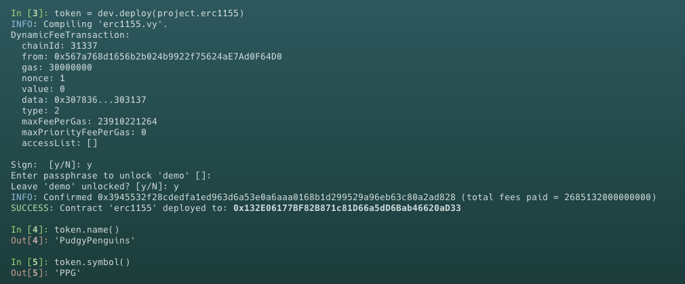
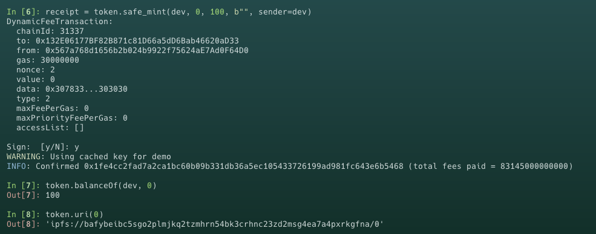
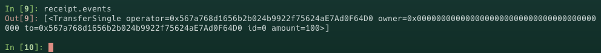
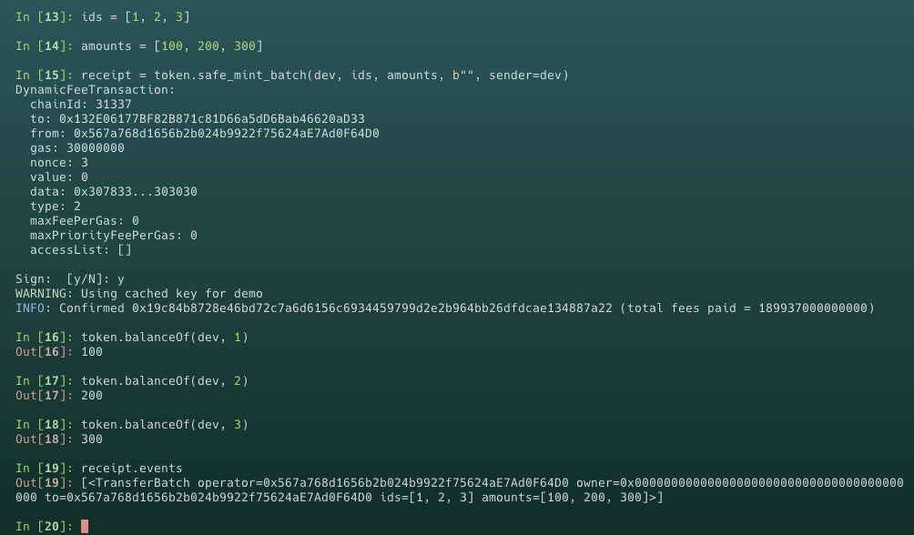

# Vyper 入门: 27. ERC1155

`ERC1155` 是一个 `Ethereum` 的代币标准，由Enjin提出，旨在创建一个统一的接口来管理多种代币类型，包括可替代的（如ERC-20）和不可替代的代币（如ERC-721）。与 `ERC721` 相比，它允许在单个合约中创建和管理多种代币，减少了交易所需的 `gas` 成本，并提高了批量转移的效率

`ERC1155` 的大多数使用场景都是在GameFi应用中，例如Decentraland、SandBox、Aavegotchi等知名链游应用都使用它。假设你想在以太坊上实现一款类似《EVE Online》的链游，使用 `ERC1155` 标准能够极大地优化游戏资产的管理。与其为每艘舰船部署一个独立的合约，不如利用 `ERC1155` 的多代币标准，在一个合约中管理所有的舰船，以及其他各种类型的游戏内物品，如装备、资源和道具等


## 与 `ERC721` 的区别
- `ERC1155` 支持多种代币类型，而 `ERC721` 仅支持非同质化代币
- 通过批量转移操作，`ERC1155` 可以在一次交易中转移多个代币，降低了交易成本
- `ERC1155` 允许代币之间的无缝转换，增加了使用代币的灵活性

在 `ERC1155` 标准中，代币的同质化或非同质化属性可以通过其发行量来区分。简单地说，如果一个特定 `ID` 的代币发行量限定为 `1`，则该代币被视为非同质化代币，这与 `ERC721` 代币相似，代表每个代币都是独一无二的。相反，如果一个特定ID的代币发行量超过 `1`，则这批代币被视为同质化代币，这类似于 `ERC20`，意味着这些代币在功能和价值上是相互可替代的，因为它们共享相同的ID。这种设计使得 `ERC1155` 能够灵活地支持多种代币类型，无论是 `NFT` 还是 `Token`，都可以在同一个智能合约框架内管理。


## 理解 `ERC1155` 标准
`ERC1155` 标准定义了一组最小的公共接口，一个 `ERC1155` 代币合约必须实现这些接口和事件，包括：

### 函数接口

- `balanceOf`: 查询账户拥有的特定代币的数量
```
balanceOf: public(HashMap[address, HashMap[uint256, uint256]])
```

- `balanceOfBatch`: 批量查询多个账户的多种代币的余额
```
@view
@external
def balanceOfBatch(accounts: DynArray[address, BATCH_SIZE], ids: DynArray[uint256, BATCH_SIZE]) -> DynArray[uint256,BATCH_SIZE]:
    return empty(DynArray[uint256, BATCH_SIZE])
```

- `safeTransferFrom`: 安全转移代币，如果 `to` 地址是合约，则会验证是否实现了` onERC1155Received` 接收函数
```
@external
def safeTransferFrom(
    _sender: address, 
    _receiver: address, 
    _id: uint256, 
    _amount: uint256, 
    _bytes: bytes32
):
    pass
```

- `safeBatchTransferFrom`: 批量安全转移代币，如果 `to` 地址是合约，则会验证是否实现了` onERC1155BatchReceived` 接收函数
```
@external
def safeBatchTransferFrom(
    _sender: address, 
    _receiver: address, 
    _ids: DynArray[uint256, BATCH_SIZE], 
    _amounts: DynArray[uint256, BATCH_SIZE], 
    _bytes: bytes32
):
    pass
```

- `setApprovalForAll`: 授权一个操作者管理你的所有 `ERC1155` 代币的权限
```
@external
def setApprovalForAll(
    _owner: address, 
    _operator: address, 
    _approved: bool
):
    pass
```

- `isApprovedForAll`: 查询操作者是否被批准管理你的所有的 `ERC1155` 代币
```
isApprovedForAll: public( HashMap[address, HashMap[address, bool]])
```

### 事件接口

- `TransferSingle`: 记录单个代币转移
```
event TransferSingle:
    operator:   indexed(address)
    fromAddress: indexed(address)
    to: indexed(address)
    id: uint256
    value: uint256

```

- `TransferBatch`: 记录多个代币转移
```
event TransferBatch:
    operator: indexed(address)
    fromAddress: indexed(address)
    to: indexed(address)
    ids: DynArray[uint256, BATCH_SIZE]
    values: DynArray[uint256, BATCH_SIZE]
```

- `ApprovalForAll`: 记录代币授权/取消授权
```
event ApprovalForAll:
    account: indexed(address)
    operator: indexed(address)
    approved: bool
```

- `URI`: 记录代币的 `URI` 变化
```
event URI:
    value: String[MAX_URI_LENGTH]
    id: indexed(uint256)
```

### ERC1155Receiver

`ERC1155Receiver` 是一种接口，专为处理 `ERC1155` 代币的接收而设计。它允许智能合约安全地接收 `ERC1155` 代币，无论是单个代币还是批量代币。这个接口确保了在代币被转移到合约地址时，合约能够正确响应并处理这些代币，避免了代币被错误发送到合约中而无法恢复的风险。

```
interface IERC1155Receiver:
    def onERC1155Received(
       operator: address,
       sender: address,
       id: uint256,
       amount: uint256,
       data: Bytes[CALLBACK_NUMBYTES],
   ) -> bytes4: payable
    def onERC1155BatchReceived(
        operator: address,
        sender: address,
        ids: DynArray[uint256, BATCH_SIZE],
        amounts: DynArray[uint256, BATCH_SIZE],
        data: Bytes[CALLBACK_NUMBYTES],
    ) -> bytes4: payable
```

当 `ERC1155` 通过 `safeTransferFrom` 函数单个转移到合约时，`onERC1155Received` 函数被调用。该函数的参数包括：

- `operator`: 执行转移操作的地址
- `sender`: 代币发送者的地址
- `id`: 被转移的代币的ID
- `amount`: 被转移的代币的数量
- `data`: 与转移一起发送的额外数据

此方法在成功处理接收的代币后，必须返回 
```
method_id("onERC1155Received(address,address,uint256,uint256,bytes)", output_type=bytes4)
```
以表明接收成功，这个返回值是 `0xf23a6e61`


当 `ERC1155` 通过 `safeBatchTransferFrom` 函数批量转移到合约时，`onERC1155BatchReceived` 函数被调用。该函数的参数包括：

- `operator`: 执行转移操作的地址
- `sender`: 代币发送者的地址
- `ids`: 被转移的代币的ID列表
- `amounts`: 对应于 `ids` 中每个代币 `ID` 的被转移代币的数量列表
- `data`: 与转移一起发送的额外数据

此方法在成功处理接收的代币后，必须返回 
```
method_id("onERC1155BatchReceived(address,address,uint256[],uint256[],bytes)", output_type=bytes4)
```
以表明接收成功，这个返回值是 `0xbc197c81`

接下来我们看一下如何在 `ERC1155` 合约中实现 `onERC1155Received` 和 `onERC1155BatchReceived` 函数:
```
interface IERC1155Receiver:
    def onERC1155Received(
       operator: address,
       sender: address,
       id: uint256,
       amount: uint256,
       data: Bytes[CALLBACK_NUMBYTES],
   ) -> bytes4: payable
    def onERC1155BatchReceived(
        operator: address,
        sender: address,
        ids: DynArray[uint256, BATCH_SIZE],
        amounts: DynArray[uint256, BATCH_SIZE],
        data: Bytes[CALLBACK_NUMBYTES],
    ) -> bytes4: payable


@internal
def _check_on_erc1155_received(
    owner: address, 
    to: address, 
    id: uint256, 
    amount: uint256, 
    data: Bytes[1024]
) -> bool:
    if (to.is_contract):
        return_value: bytes4 = extcall IERC1155Receiver(to).onERC1155Received(msg.sender, owner, id, amount, data)
        assert return_value == method_id("onERC1155Received(address,address,uint256,uint256,bytes)", output_type=bytes4)
        return True
    else:
        return True


@internal
def _check_on_erc1155_batch_received(
    owner: address, 
    to: address, 
    ids: DynArray[uint256, _BATCH_SIZE], 
    amounts: DynArray[uint256, _BATCH_SIZE],
    data: Bytes[1024]
) -> bool:
    if (to.is_contract):
        return_value: bytes4 = extcall IERC1155Receiver(to).onERC1155BatchReceived(msg.sender, owner, ids, amounts, data)
        assert return_value == method_id("onERC1155BatchReceived(address,address,uint256[],uint256[],bytes)", output_type=bytes4)
        return True
    else:
        return True
```


## 部署 `ERC1155`
接下来我们部署一个 `ERC1155` 代币，示例代码如下：
```
# pragma version 0.4.3

from ethereum.ercs import IERC165 as ERC165
implements: ERC165


interface IERC1155Receiver:
    def onERC1155Received(
       operator: address,
       sender: address,
       id: uint256,
       amount: uint256,
       data: Bytes[_CALLBACK_NUMBYTES],
   ) -> bytes4: payable
    def onERC1155BatchReceived(
        operator: address,
        sender: address,
        ids: DynArray[uint256, _BATCH_SIZE],
        amounts: DynArray[uint256, _BATCH_SIZE],
        data: Bytes[_CALLBACK_NUMBYTES],
    ) -> bytes4: payable


event TransferSingle:
    operator: indexed(address)
    owner: indexed(address)
    to: indexed(address)
    id: uint256
    amount: uint256

event TransferBatch:
    operator: indexed(address)
    owner: indexed(address)
    to: indexed(address)
    ids: DynArray[uint256, _BATCH_SIZE]
    amounts: DynArray[uint256, _BATCH_SIZE]

event ApprovalForAll:
    owner: indexed(address)
    operator: indexed(address)
    approved: bool

event URI:
    value: String[512]
    id: indexed(uint256)


_SUPPORTED_INTERFACES: constant(bytes4[3]) = [
    0x01FFC9A7, 
    0xD9B67A26, 
    0x0E89341C
]


_BATCH_SIZE: constant(uint16) = 255
_BASE_URI: immutable(String[80])
_CALLBACK_NUMBYTES: constant(uint256) = 4096

isApprovedForAll: public(HashMap[address, HashMap[address, bool]])
total_supply: public(HashMap[uint256, uint256])
is_minter: public(HashMap[address, bool])
owner: public(address)
_balances: HashMap[uint256, HashMap[address, uint256]]
_token_uris: HashMap[uint256, String[432]]


@deploy
@payable
def __init__():
    _BASE_URI = "ipfs://bafybeibc5sgo2plmjkq2tzmhrn54bk3crhnc23zd2msg4ea7a4pxrkgfna/"
    self.is_minter[msg.sender] = True


@external
@view
def supportsInterface(interface_id: bytes4) -> bool:
    return interface_id in _SUPPORTED_INTERFACES


@external
def safeTransferFrom(owner: address, to: address, id: uint256, amount: uint256, data: Bytes[1_024]):
    assert owner == msg.sender or self.isApprovedForAll[owner][msg.sender], "ERC1155: caller is not token owner or approved"
    self._safe_transfer_from(owner, to, id, amount, data)


@external
def safeBatchTransferFrom(owner: address, to: address, ids: DynArray[uint256, _BATCH_SIZE], amounts: DynArray[uint256, _BATCH_SIZE],
                          data: Bytes[1_024]):
    assert owner == msg.sender or self.isApprovedForAll[owner][msg.sender], "ERC1155: caller is not token owner or approved"
    self._safe_batch_transfer_from(owner, to, ids, amounts, data)


@external
@view
def balanceOf(owner: address, id: uint256) -> uint256:
    return self._balance_of(owner, id)


@external
@view
def balanceOfBatch(owners: DynArray[address, _BATCH_SIZE], ids: DynArray[uint256, _BATCH_SIZE]) -> DynArray[uint256, _BATCH_SIZE]:
    assert len(owners) == len(ids), "ERC1155: owners and ids length mismatch"
    batch_balances: DynArray[uint256, _BATCH_SIZE] = []
    idx: uint256 = empty(uint256)
    for owner: address in owners:
        batch_balances.append(self._balance_of(owner, ids[idx]))
        idx = unsafe_add(idx, 1)
    return batch_balances


@external
def setApprovalForAll(operator: address, approved: bool):
    self._set_approval_for_all(msg.sender, operator, approved)


@external
@view
def uri(id: uint256) -> String[512]:
    return self._uri(id)


@external
def set_uri(id: uint256, token_uri: String[432]):
    assert self.is_minter[msg.sender], "AccessControl: access is denied"
    self._set_uri(id, token_uri)


@external
def burn(owner: address, id: uint256, amount: uint256):
    assert owner == msg.sender or self.isApprovedForAll[owner][msg.sender], "ERC1155: caller is not token owner or approved"
    self._burn(owner, id, amount)


@external
def burn_batch(owner: address, ids: DynArray[uint256, _BATCH_SIZE], amounts: DynArray[uint256, _BATCH_SIZE]):
    assert owner == msg.sender or self.isApprovedForAll[owner][msg.sender], "ERC1155: caller is not token owner or approved"
    self._burn_batch(owner, ids, amounts)


@external
def safe_mint(owner: address, id: uint256, amount: uint256, data: Bytes[1_024]):
    assert self.is_minter[msg.sender], "AccessControl: access is denied"
    self._safe_mint(owner, id, amount, data)


@external
def safe_mint_batch(owner: address, ids: DynArray[uint256, _BATCH_SIZE], amounts: DynArray[uint256, _BATCH_SIZE], data: Bytes[1_024]):
    assert self.is_minter[msg.sender], "AccessControl: access is denied"
    self._safe_mint_batch(owner, ids, amounts, data)


@internal
def _set_approval_for_all(owner: address, operator: address, approved: bool):
    assert owner != operator, "ERC1155: setting approval status for self"
    self.isApprovedForAll[owner][operator] = approved
    log ApprovalForAll(owner, operator, approved)


@internal
def _safe_transfer_from(owner: address, to: address, id: uint256, amount: uint256, data: Bytes[1_024]):
    assert to != empty(address), "ERC1155: transfer to the zero address"

    self._before_token_transfer(owner, to, self._as_singleton_array(id), self._as_singleton_array(amount), data)

    owner_balance: uint256 = self._balances[id][owner]
    assert owner_balance >= amount, "ERC1155: insufficient balance for transfer"
    self._balances[id][owner] = unsafe_sub(owner_balance, amount)
    self._balances[id][to] = unsafe_add(self._balances[id][to], amount)
    log TransferSingle(msg.sender, owner, to, id, amount)

    self._after_token_transfer(owner, to, self._as_singleton_array(id), self._as_singleton_array(amount), data)

    assert self._check_on_erc1155_received(owner, to, id, amount, data), "ERC1155: transfer to non-ERC1155Receiver implementer"


@internal
def _safe_batch_transfer_from(owner: address, to: address, ids: DynArray[uint256, _BATCH_SIZE], amounts: DynArray[uint256, _BATCH_SIZE],
                              data: Bytes[1_024]):
    assert len(ids) == len(amounts), "ERC1155: ids and amounts length mismatch"
    assert to != empty(address), "ERC1155: transfer to the zero address"

    self._before_token_transfer(owner, to, ids, amounts, data)

    idx: uint256 = empty(uint256)
    for id: uint256 in ids:
        amount: uint256 = amounts[idx]
        owner_balance: uint256 = self._balances[id][owner]
        assert owner_balance >= amount, "ERC1155: insufficient balance for transfer"
        self._balances[id][owner] = unsafe_sub(owner_balance, amount)
        self._balances[id][to] = unsafe_add(self._balances[id][to], amount)
        idx = unsafe_add(idx, 1)

    log TransferBatch(msg.sender, owner, to, ids, amounts)

    self._after_token_transfer(owner, to, ids, amounts, data)

    assert self._check_on_erc1155_batch_received(owner, to, ids, amounts, data), "ERC1155: transfer to non-ERC1155Receiver implementer"


@internal
@view
def _balance_of(owner: address, id: uint256) -> uint256:
    assert owner != empty(address), "ERC1155: address zero is not a valid owner"
    return self._balances[id][owner]


@internal
def _safe_mint(owner: address, id: uint256, amount: uint256, data: Bytes[1_024]):
    assert owner != empty(address), "ERC1155: mint to the zero address"

    self._before_token_transfer(empty(address), owner, self._as_singleton_array(id), self._as_singleton_array(amount), data)
    self._balances[id][owner] = unsafe_add(self._balances[id][owner], amount)
    log TransferSingle(msg.sender, empty(address), owner, id, amount)

    self._after_token_transfer(empty(address), owner, self._as_singleton_array(id), self._as_singleton_array(amount), data)

    assert self._check_on_erc1155_received(empty(address), owner, id, amount, data), "ERC1155: mint to non-ERC1155Receiver implementer"


@internal
def _safe_mint_batch(owner: address, ids: DynArray[uint256, _BATCH_SIZE], amounts: DynArray[uint256, _BATCH_SIZE], data: Bytes[1_024]):

    assert len(ids) == len(amounts), "ERC1155: ids and amounts length mismatch"
    assert owner != empty(address), "ERC1155: mint to the zero address"

    self._before_token_transfer(empty(address), owner, ids, amounts, data)

    idx: uint256 = empty(uint256)
    for id: uint256 in ids:
        self._balances[id][owner] = unsafe_add(self._balances[id][owner], amounts[idx])
        idx = unsafe_add(idx, 1)

    log TransferBatch(msg.sender, empty(address), owner, ids, amounts)

    self._after_token_transfer(empty(address), owner, ids, amounts, data)

    assert self._check_on_erc1155_batch_received(empty(address), owner, ids, amounts, data), "ERC1155: transfer to non-ERC1155Receiver implementer"


@internal
@view
def _uri(id: uint256) -> String[512]:
    token_uri: String[432] = self._token_uris[id]

    base_uri_length: uint256 = len(_BASE_URI)
    if (base_uri_length == empty(uint256)):
        return token_uri

    if (len(token_uri) != empty(uint256)):
        return concat(_BASE_URI, token_uri)

    if (base_uri_length != empty(uint256)):
        return concat(_BASE_URI, uint2str(id))
    else:
        return ""


@internal
def _set_uri(id: uint256, token_uri: String[432]):
    self._token_uris[id] = token_uri
    log URI(self._uri(id), id)


@internal
def _burn(owner: address, id: uint256, amount: uint256):
    assert owner != empty(address), "ERC1155: burn from the zero address"

    self._before_token_transfer(owner, empty(address), self._as_singleton_array(id), self._as_singleton_array(amount), b"")
    owner_balance: uint256 = self._balances[id][owner]
    assert owner_balance >= amount, "ERC1155: burn amount exceeds balance"
    self._balances[id][owner] = unsafe_sub(owner_balance, amount)
    log TransferSingle(msg.sender, owner, empty(address), id, amount)

    self._after_token_transfer(owner, empty(address), self._as_singleton_array(id), self._as_singleton_array(amount), b"")


@internal
def _burn_batch(owner: address, ids: DynArray[uint256, _BATCH_SIZE], amounts: DynArray[uint256, _BATCH_SIZE]):
    assert len(ids) == len(amounts), "ERC1155: ids and amounts length mismatch"
    assert owner != empty(address), "ERC1155: burn from the zero address"

    self._before_token_transfer(owner, empty(address), ids, amounts, b"")

    idx: uint256 = empty(uint256)
    for id: uint256 in ids:
        amount: uint256 = amounts[idx]
        owner_balance: uint256 = self._balances[id][owner]
        assert owner_balance >= amount, "ERC1155: burn amount exceeds balance"
        self._balances[id][owner] = unsafe_sub(owner_balance, amount)
        idx = unsafe_add(idx, 1)

    log TransferBatch(msg.sender, owner, empty(address), ids, amounts)

    self._after_token_transfer(owner, empty(address), ids, amounts, b"")


@internal
def _check_on_erc1155_received(owner: address, to: address, id: uint256, amount: uint256, data: Bytes[1_024]) -> bool:
    if (to.is_contract):
        return_value: bytes4 = extcall IERC1155Receiver(to).onERC1155Received(msg.sender, owner, id, amount, data)
        assert return_value == method_id("onERC1155Received(address,address,uint256,uint256,bytes)", output_type=bytes4)
        return True
    else:
        return True


@internal
def _check_on_erc1155_batch_received(owner: address, to: address, ids: DynArray[uint256, _BATCH_SIZE], amounts: DynArray[uint256, _BATCH_SIZE], data: Bytes[1_024]) -> bool:

    if (to.is_contract):
        return_value: bytes4 = extcall IERC1155Receiver(to).onERC1155BatchReceived(msg.sender, owner, ids, amounts, data)
        assert return_value == method_id("onERC1155BatchReceived(address,address,uint256[],uint256[],bytes)", output_type=bytes4)
        return True
    else:
        return True


@internal
def _before_token_transfer(owner: address, to: address, ids: DynArray[uint256, _BATCH_SIZE], amounts: DynArray[uint256, _BATCH_SIZE], data: Bytes[1_024]):

    if (owner == empty(address)):
        idx: uint256 = empty(uint256)
        for id: uint256 in ids:
            self.total_supply[id] += amounts[idx]
            idx = unsafe_add(idx, 1)

    if (to == empty(address)):
        idx: uint256 = empty(uint256)
        for id: uint256 in ids:
            amount: uint256 = amounts[idx]
            supply: uint256 = self.total_supply[id]
            assert supply >= amount, "ERC1155: burn amount exceeds total_supply"
            self.total_supply[id] = unsafe_sub(supply, amount)
            idx = unsafe_add(idx, 1)


@internal
def _after_token_transfer(owner: address, to: address, ids: DynArray[uint256, _BATCH_SIZE], amounts: DynArray[uint256, _BATCH_SIZE], data: Bytes[1_024]):
    pass


@internal
@pure
def _as_singleton_array(element: uint256) -> DynArray[uint256, 1]:
    return [element]
```


**编译合约并部署**



现在我们已经成功部署一个名称为 `PudgyPenguins` 的 `ERC1155` 代币 ，接下来我们需要调用 `safe_mint()` 函数给自己铸造一些代币



可以看到我们成功为自己铸造了 `100` 个 `0` 号 `PudgyPenguins` 代币

打印 `log` 我们已经看到里面包含6个信息



- 事件 `TransferSingle`
- 操作者 `0x567a768d1656b2b024b9922f75624aE7Ad0F64D0`
- 铸币地址 `0x0000000000000000000000000000000000000000`
- 接收地址 `0x567a768d1656b2b024b9922f75624aE7Ad0F64D0`
- tokenID `0`
- 数量 `100`

接下来我们尝试批量铸造 `1`、`2`、`3`号代币数量分别为 `100`、`200`、`300`，批量铸造单个铸造类似



## 总结
本节中，我们介绍了 `ERC1155` 标准并部署了一个代币。需要注意教程中使用的示例代码，仅作教学使用，不适用于生产